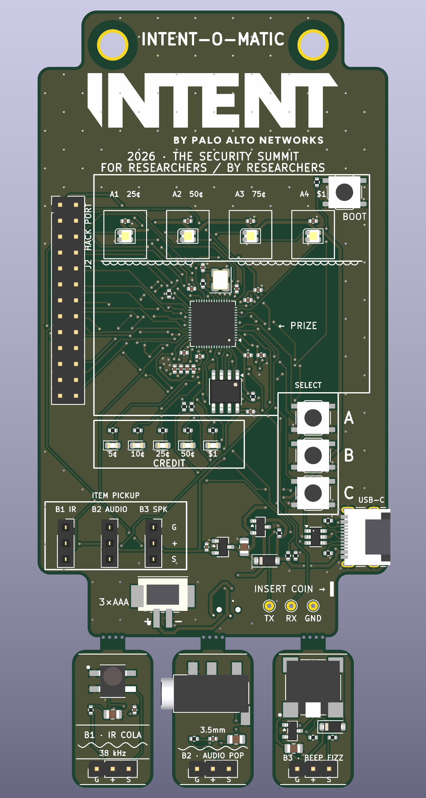
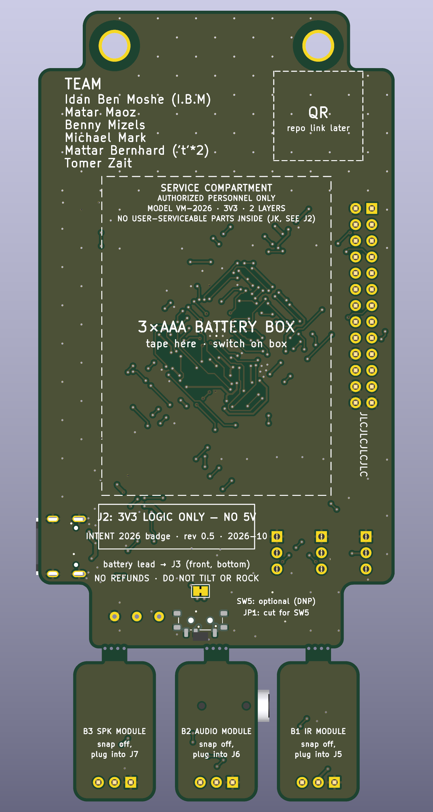
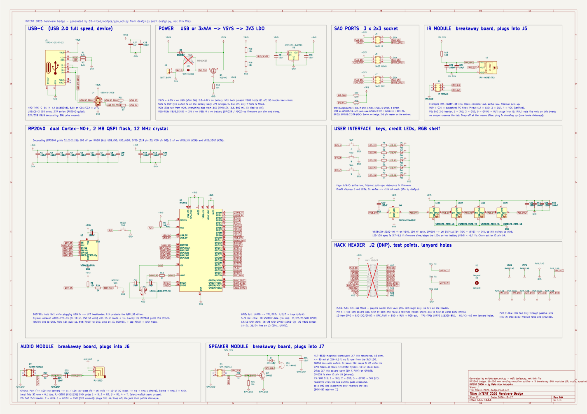

# INTENT 2026 Hardware Badge

RP2040 conference badge for the INTENT 2026 security summit, shaped like a vending machine: a header sign
with the lanyard holes, the cabinet with the product window, keypad and item-pickup door, and a pedestal.
56 × 100 mm, two layers, purple solder mask, with three **breakaway soda-can modules** (IR receiver,
audio jack, speaker) that snap off and plug back into slots on the badge.

Board rev **0.5** (2026-10-11). Fab target: JLCPCB, Standard PCBA.

  
  &nbsp;&nbsp;&nbsp;
  

## Schematic

- **PDF:** [04-fab/intent-2026-badge-schematic.pdf](04-fab/intent-2026-badge-schematic.pdf)
- Source: [03-kicad/intent-2026-badge.kicad_sch](03-kicad/intent-2026-badge.kicad_sch) (generated, see below)

## What is on the board

| Block | Parts |
|---|---|
| MCU | RP2040 (U1), 16 Mbit QSPI flash (U2), 12 MHz crystal, BOOTSEL key SW1 |
| USB | USB-C receptacle (J1), USBLC6-2 ESD array, 27 Ω series resistors |
| Power | USB or 3×AAA battery (J3) through a P-MOSFET / Schottky power path, ME6206 3.3 V LDO |
| User interface | Keys A / B / C (GPIO4 / 3 / 2), five red "credit" LEDs (GPIO5–9), four WS2812B-2020 RGB LEDs on the shelf (GPIO10) |
| Hack header | J2, 2×13 pins (not fitted): 15 GPIO, SWD, RUN, 3V3, GND, RGB chain out; UART0 on test pads TX / RX / GND |
| Expansion slots | J5 **IR** (GPIO22), J6 **AUDIO** (GPIO11), J7 **SPK** (GPIO25). 1×3 sockets, pin 1 = GND, 2 = 3V3, 3 = signal |

### Breakaway modules

The three modules are 13 × 22 mm soda cans hanging under the pedestal on 4 mm tabs with mouse bites. Snap them off, then plug each one
into its slot. Every port has the same pinout (GND / 3V3 / signal, power in the middle), so a module plugged
in backwards swaps ground and signal and never puts 3V3 on a GPIO.

The silkscreen plays along: the RGB LEDs are shelf items A1–A4 with price tags over a dispensing coil, the keys sit in a
SELECT bezel, the five red LEDs are the CREDIT meter, the module slots are the ITEM PICKUP door, and the UART test pads
are the coins. The modules are the vended drinks.

| Item | Module | Circuit | Slot |
|---|---|---|---|
| B1 "IR COLA" | IR | Everlight IRM-H638T 38 kHz receiver with RC supply filter | J5, GPIO22 |
| B2 "AUDIO POP" | AUDIO | 3.5 mm TRRS jack behind a 1 k / 10 n PWM low-pass and 10 µF DC block | J6, GPIO11 (PWM) |
| B3 "BEEP FIZZ" | SPK | MLT-8530 magnetic transducer, S8050 low-side driver, flyback diode | J7, GPIO25 (2.7 kHz square wave) |

## Repository layout

| Folder | Content |
|---|---|
| `00-bom/` | Priced BOM (B2) and the change log on top of it (`bom-deltas.md`, Hebrew mirror) |
| `01-spec/` | Design spec: outline, power tree, net list, GPIO map, modules |
| `02-layout/` | Placement plan, front/back mockups, logo artwork |
| `03-kicad/` | KiCad project **and the scripts that generate it** (see `BUILD-NOTES.md`) |
| `04-fab/` | Gerbers, JLC BOM/CPL, DRC/ERC reports, renders, schematic PDF, order spec |
| `05-firmware-notes/` | GPIO map and notes for the firmware |

## How the design is built

The KiCad files are generated, not hand-drawn:

- `03-kicad/scripts/design.py` is the netlist (parts, pins, nets, LCSC numbers).
- `placement.py` holds every coordinate, including the module rectangles and tabs.
- `gen_sch.py` draws the wired schematic, `pcb_build.py` creates the board and outline,
  `router/route2.py` routes it, `pcb_finish.py` adds pours and silkscreen, `fab_export.py` writes the JLC files.
- `check_sch.py --erc` proves the schematic matches `design.py` pin for pin and runs ERC.

Current status: ERC 0 errors, DRC 0 violations and 0 unconnected pads (KiCad 10.0.3).
Order details and the pre-order checklist are in [`04-fab/order-spec.md`](04-fab/order-spec.md).

## Team

Idan Ben Moshe, Matar Maoz, Benny Mizels, Michael Mark, Mattar Bernhard, Tomer Zait.
